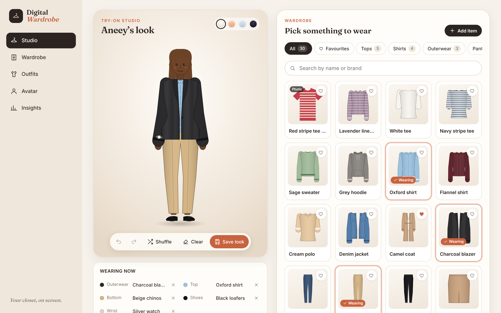
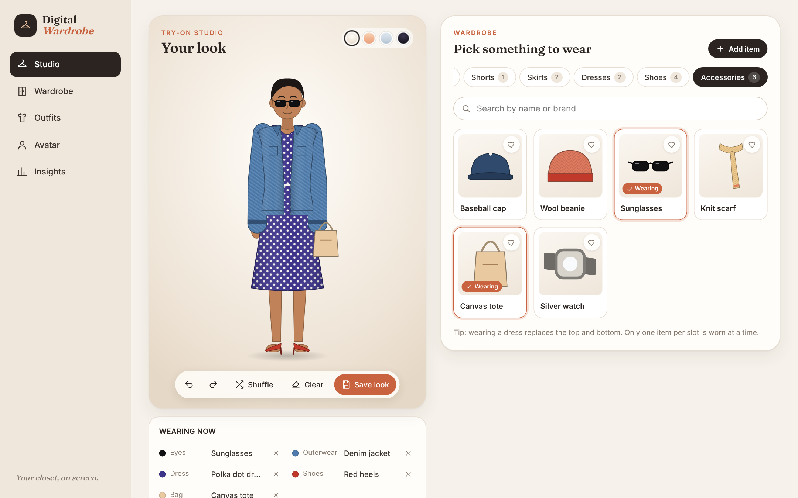
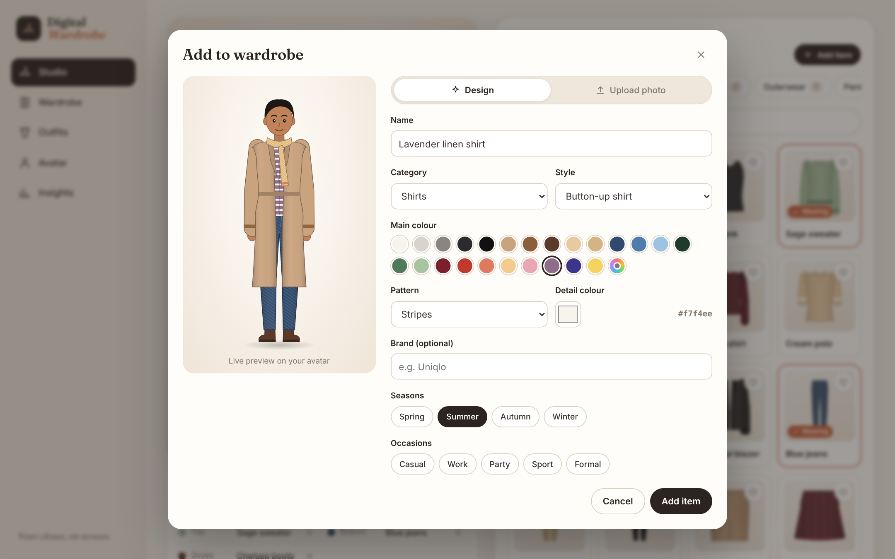
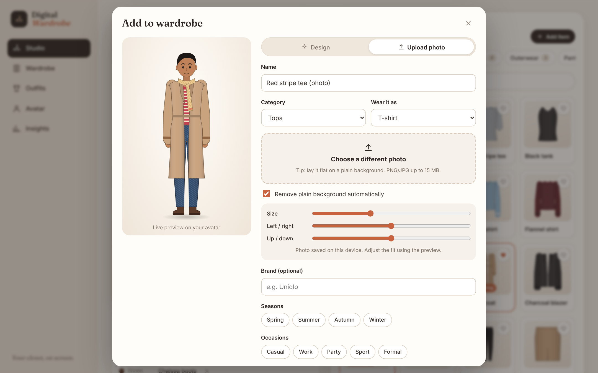
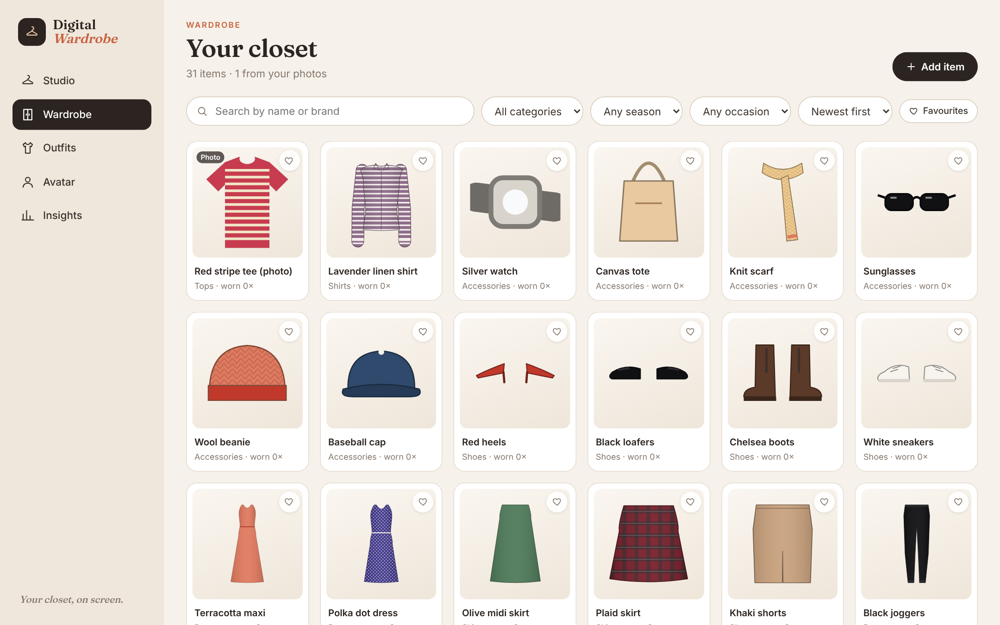
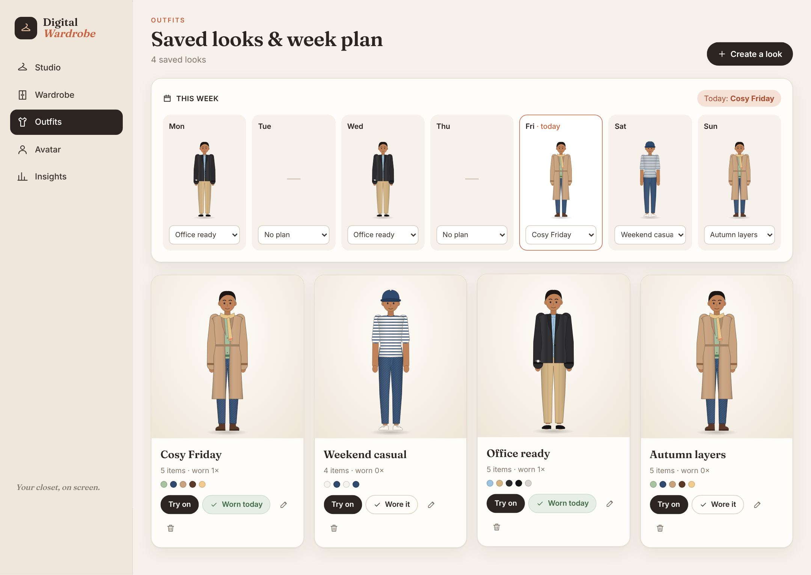
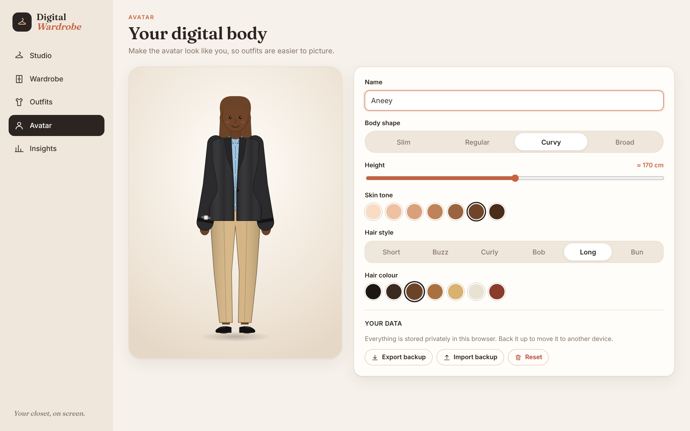
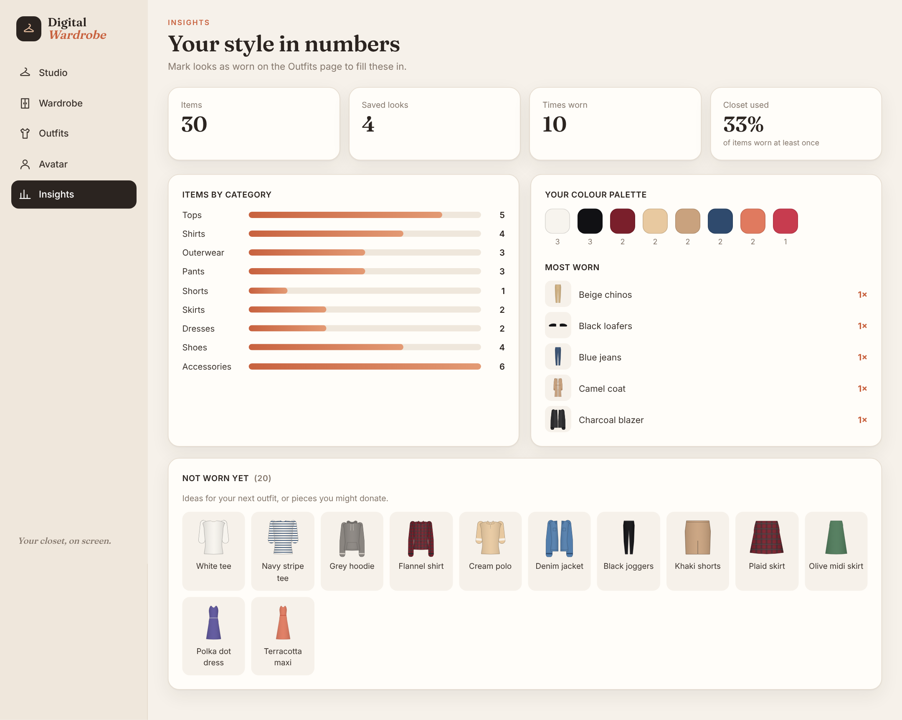
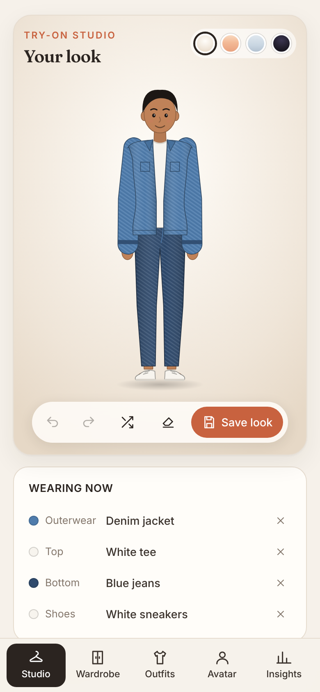

# 👗 Digital Wardrobe

**A virtual closet and try-on app.** Build a digital version of yourself, fill a wardrobe with your clothes (designed in the app or uploaded as photos), and dress your avatar on screen to mix, match, save and plan outfits before you wear them.



## ✨ Features

### 🧍 Your digital body
- Customisable **avatar**: body shape (slim, regular, curvy, broad), height, skin tone, hair style and hair colour
- Clothes are drawn **parametrically**, so every garment adapts to the chosen body shape

### 🪞 Try-on studio
- Avatar on the left, **wardrobe sectioned by category** on the right: Tops, Shirts, Outerwear, Pants, Shorts, Skirts, Dresses, Shoes and Accessories
- Click to put an item on or take it off, with realistic **layering rules**: one item per slot, and a dress replaces the top and bottom
- **Undo / redo** (Ctrl+Z / Ctrl+Shift+Z), **Shuffle** for a random outfit, Clear and **Save look**
- Four stage backgrounds, a "Wearing now" list, search and favourites

### 👚 Wardrobe
- **Design an item**: pick a style (tee, shirt, blazer, jeans, dress, boots…), colours and pattern (stripes, checks, dots, denim, knit)
- **Upload a photo** of your own clothing: it's resized, the plain background is removed automatically, it's trimmed, and its main colour is detected; then fine-tune the fit on the avatar with live preview
- Tag by season and occasion, add brand, favourite; filter, search and sort

### 📅 Outfits & planner
- Saved looks shown on your avatar; **Try on**, **Wore it today**, rename and delete
- **Weekly planner** to assign a look to each day, with today highlighted

### 📊 Insights
- Item, outfit and wear counts, plus **closet utilisation** (share of items actually worn)
- Items by category, your colour palette, most-worn pieces, and items not worn yet (closet cleanup ideas)

### 🔒 Private by design
- Everything is stored **locally in your browser** (IndexedDB, including photos); no account or server needed
- **Export / import** a JSON backup (photos included) and reset

## 📸 Screenshots

| Studio | Add item (design) |
|---|---|
|  |  |
| **Add item (photo upload)** | **Wardrobe** |
|  |  |
| **Outfits & week planner** | **Avatar** |
|  |  |
| **Insights** | **Mobile** |
|  |  |

## 🛠️ Tech stack

| Area | Technology |
|---|---|
| UI | **React 18** + **TypeScript** (strict) |
| Build | **Vite** |
| Routing | React Router (hash routing, works on static hosting) |
| Graphics | Hand-built **parametric SVG** avatar and garment engine |
| State | `useReducer` + Context store with undo/redo history |
| Storage | **IndexedDB** (data + photo blobs), debounced autosave |
| Images | Canvas API: resize, flood-fill background removal, auto-trim, dominant colour |
| Testing | **Vitest** unit tests for outfit rules, store and insights |
| CI | GitHub Actions: typecheck, test and build on every push |

## 🏗️ Architecture

```
src/
├── avatar/
│   ├── geometry.ts     # Body measurements per shape + path builders (torso, sleeves, legs, skirts)
│   ├── garments.tsx    # 30+ garment templates, patterns, shading
│   └── Avatar.tsx      # Avatar renderer, layer order, photo items, item thumbnails
├── components/         # ItemCard, ItemEditor (live preview + photo upload), UI kit
├── lib/
│   ├── types.ts        # Domain model: Item, Look, Outfit, Avatar, slots
│   ├── catalog.ts      # Categories, templates, palettes, starter wardrobe
│   ├── outfit.ts       # Layering rules, shuffle, look helpers
│   ├── store.tsx       # Reducer, persistence, undo/redo
│   ├── db.ts           # IndexedDB wrapper (with in-memory fallback)
│   ├── image.ts        # Photo processing
│   ├── insights.ts     # Wardrobe statistics
│   └── backup.ts       # Export / import
├── pages/              # Studio, Wardrobe, Outfits, Avatar, Insights
└── styles/app.css      # Design system and responsive layout
```

**How layering works:** every item maps to a body *slot* (`top`, `bottom`, `dress`, `outer`, `shoes`, `head`, `eyes`, `neck`, `bag`, `wrist`). A look is a map of slot → item. Wearing an item replaces whatever is in its slot, and `dress` is mutually exclusive with `top` and `bottom`. Slots are drawn back-to-front (shoes → bottom → top → dress → outer → accessories) so garments overlap naturally.

## 🚀 Getting started

**Requirements:** Node.js 18+

```bash
npm install
npm run dev        # http://localhost:5173
```

```bash
npm test           # unit tests
npm run typecheck  # TypeScript
npm run build      # production build in dist/
npm run preview    # serve the build
```

Because it uses hash routing and no backend, the `dist/` folder can be deployed as-is to GitHub Pages, Netlify or Vercel.

## 🔮 Roadmap

- AI outfit suggestions based on weather, occasion and wear history
- Real photo try-on with body-pose detection
- Cloud sync and sharing looks with friends
- Packing lists for trips

## 📄 License

[MIT](LICENSE) © Aneey
